# 📖 คู่มือการใช้งานระบบ "เรื่องราว 2026" (Photostory User Manual)
### บันทึกความทรงจำส่วนบุคคล · Local-First · เทคโนโลยี AI ออนดีไวซ์ 100%

---

## สารบัญ (Table of Contents)
1. [บทนำและแนวคิดการออกแบบ (Introduction & Architecture Overview)](#1-บทนำและแนวคิดการออกแบบ)
2. [คู่มือการใช้งานระบบฉบับสมบูรณ์ (User Guide)](#2-คู่มือการใช้งานระบบฉบับสมบูรณ์)
   - 2.1 [การเริ่มต้นเปิดโปรแกรม (Getting Started)](#21-การเริ่มต้นเปิดโปรแกรม)
   - 2.2 [การนำเข้ารูปภาพ (Photo Ingestion)](#22-การนำเข้ารูปภาพ)
   - 2.3 [มุมมองรูปทั้งหมดและการจัดการรูปภาพ (Photos View & Modal)](#23-มุมมองรูปทั้งหมดและการจัดการรูปภาพ)
   - 2.4 [เหตุการณ์และไทม์ไลน์ (Events View)](#24-เหตุการณ์และไทม์ไลน์)
   - 2.5 [เพื่อนและความสัมพันธ์ (Friends & Social Insights)](#25-เพื่อนและความสัมพันธ์)
   - 2.6 [เรื่องราวเฉพาะเรื่องและไดอารี่มื้ออาหาร (Thematic Collections & Meal Diary)](#26-เรื่องราวเฉพาะเรื่องและไดอารี่มื้ออาหาร)
   - 2.7 [สถานที่และแผนที่ความทรงจำ (Places & Map View)](#27-สถานที่และแผนที่ความทรงจำ)
   - 2.8 [สรุปความทรงจำประจำเดือนและประจำปี (Recap Stories)](#28-สรุปความทรงจำประจำเดือนและประจำปี)
   - 2.9 [การสำรองและกู้คืนข้อมูล (Backup & Restore)](#29-การสำรองและกู้คืนข้อมูล)
3. [เจาะลึกเทคโนโลยี AI และเบื้องหลังการทำงาน (Under-the-Hood AI Technologies)](#3-เจาะลึกเทคโนโลยี-ai-และเบื้องหลังการทำงาน)
   - 3.1 [การจัดกลุ่มเหตุการณ์ตามเวลาและพิกัด (Spatiotemporal Event Clustering)](#31-การจัดกลุ่มเหตุการณ์ตามเวลาและพิกัด)
   - 3.2 [การตรวจจับรูปถ่ายรัวและรูปซ้ำ (Burst Detection & Perceptual Hashing)](#32-การตรวจจับรูปถ่ายรัวและรูปซ้ำ)
   - 3.3 [การตรวจจับและรู้จำใบหน้า (Face Detection, Embedding & Clustering)](#33-การตรวจจับและรู้จำใบหน้า)
   - 3.4 [การค้นหาความหมายด้วยภาษาไทย (Multilingual Semantic Search via CLIP)](#34-การค้นหาความหมายด้วยภาษาไทย)
   - 3.5 [ระบบสืบค้นข้อความภาษาไทยเต็มรูปแบบ (Thai Full-Text Search via FTS5 Trigram)](#35-ระบบสืบค้นข้อความภาษาไทยเต็มรูปแบบ)
   - 3.6 [การจัดกลุ่มมื้ออาหารและจับคู่พิกัด (Meal Grouping & Geofencing)](#36-การจัดกลุ่มมื้ออาหารและจับคู่พิกัด)
   - 3.7 [การคัดเลือกรูปยอดเยี่ยมและแต่งบทความเล่าเรื่อง (Keeper Heuristics & Storytelling)](#37-การคัดเลือกรูปยอดเยี่ยมและแต่งบทความเล่าเรื่อง)
   - 3.8 [สถาปัตยกรรมประมวลผลเบื้องหลัง (Background Workers & Job Resilience)](#38-สถาปัตยกรรมประมวลผลเบื้องหลัง)
4. [ข้อกำหนดระบบและการดูแลรักษา (System Requirements & FAQ)](#4-ข้อกำหนดระบบและการดูแลรักษา)
5. [รวมภาพหน้าจอการใช้งานจริง (Visual Interface Gallery)](#5-รวมภาพหน้าจอการใช้งานจริง)

---

## 1. บทนำและแนวคิดการออกแบบ

ระบบ **"เรื่องราว 2026" (Photostory)** ถูกสร้างขึ้นเพื่อตอบโจทย์ผู้ใช้งานที่ถ่ายรูปบันทึกชีวิตประจำวันปีละหลายพันถึงหลายหมื่นรูป ทั้งรูปอาหารและเครื่องดื่มทุกมื้อ, บรรยากาศงานสัมมนา, สไลด์การบรรยาย, รูปกับเพื่อนฝูง, และความคืบหน้าของสถานที่ (เช่น การตกแต่งคอนโด หรือบ้านที่ไปเยี่ยมเยียน)

### ปรัชญาหลักในการทำงาน (Core Principles)
1. **Local-First & 100% Privacy:** รูปภาพต้นฉบับ ฐานข้อมูล และโมเดล AI ทั้งหมดทำงานอยู่บนเครื่องคอมพิวเตอร์ของคุณเองโดยตรง ไม่มีการส่งข้อมูลใด ๆ ออกไปยังคลาวด์ภายนอก
2. **Scan-in-Place & Non-destructive:** ไฟล์ภาพต้นฉบับจะไม่มีการถูกเคลื่อนย้าย เปลี่ยนชื่อ ลบ หรือดัดแปลงพิกเซลโดยเด็ดขาด ระบบเก็บเพียง Path และภาพขนาดย่อ (Thumbnail)
3. **The Two-Axis Model (โมเดลการจัดระเบียบ 2 แกนอิสระ):**
   - **แกนที่ 1: เหตุการณ์ (Events Axis):** จัดกลุ่มอัตโนมัติจากวันเวลาและพิกัด GPS เพื่อบอกว่า *"เกิดอะไรขึ้น เมื่อไหร่ ที่ไหน"* โดย 1 รูปจะอยู่ใน 1 เหตุการณ์เสมอ
   - **แกนที่ 2: เรื่องราวตามหัวข้อ (Thematic Stories Axis):** รวมรูปข้ามเวลาและข้ามเหตุการณ์มาร้อยเรียงตามหัวข้อ เช่น *ไดอารี่มื้ออาหาร (Meal Diary)*, *ไทม์ไลน์ตกแต่งคอนโด*, หรือ *สมุดบันทึกสไลด์น่าสนใจ* โดย 1 รูปสามารถสังกัดได้หลายเรื่องราว

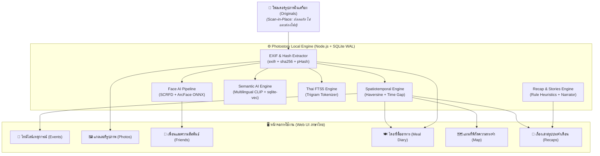

---

## 2. คู่มือการใช้งานระบบฉบับสมบูรณ์

### 2.1 การเริ่มต้นเปิดโปรแกรม (Getting Started)
1. เปิด Terminal หรือ PowerShell ในโฟลเดอร์โปรเจกต์ `photostory`
2. เริ่มการทำงานของระบบด้วยคำสั่ง:
   ```bash
   npm start
   ```
3. เปิดเว็บเบราว์เซอร์แล้วไปที่: `http://127.0.0.1:3000`

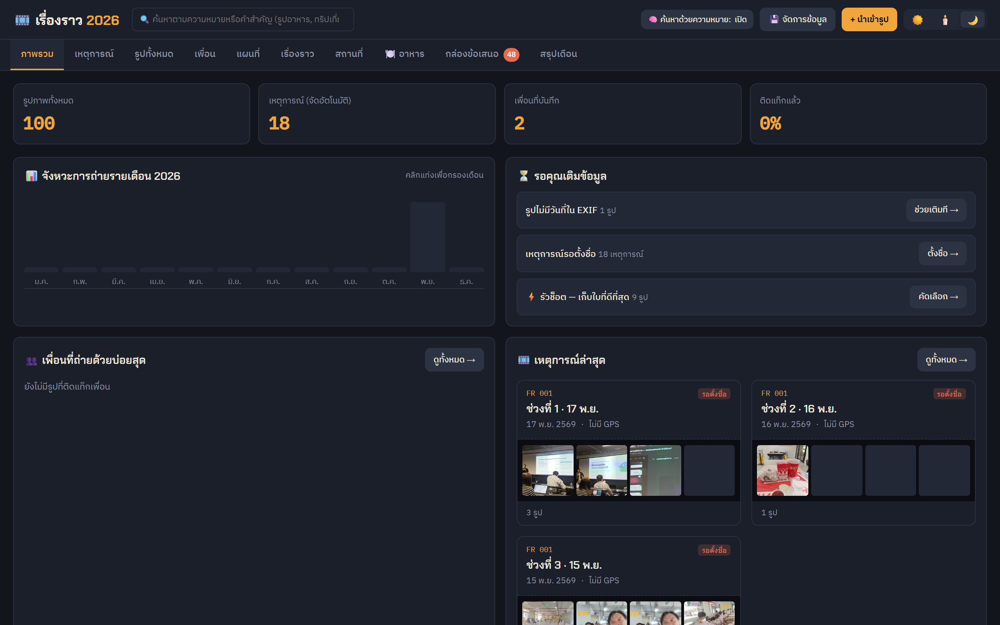
*ภาพที่ 1: หน้าภาพรวม (Dashboard) แสดงสถิติรวมทั้งหมด กราฟฮิสโตแกรมรายเดือน คิวรอคุณเติมข้อมูล และเพื่อนที่พบบ่อย*

---

### 2.2 การนำเข้ารูปภาพ (Photo Ingestion)
คุณสามารถนำเข้ารูปภาพจากคอมพิวเตอร์ได้หลายวิธี โดยระบบรองรับรูปภาพฟอร์แมต `.jpg`, `.jpeg`, `.png`, และ `.webp`:

* **วิธีที่ 1: สแกนโฟลเดอร์หลักพร้อมโฟลเดอร์ย่อยทั้งหมด (Recursive Scan)**
  - ใส่ที่อยู่ของโฟลเดอร์หลัก เช่น `D:\Photos\2026`
  - ระบบจะเดินสำรวจเข้าไปในโฟลเดอร์ย่อยทั้งหมดที่อยู่ภายใน และนำเข้ารูปทั้งหมดอย่างสมบูรณ์
* **วิธีที่ 2: นำเข้าจากหลายโฟลเดอร์พร้อมกันในครั้งเดียว (Multi-path Input)**
  - คุณสามารถป้อนหรือวางหลาย Path คั่นด้วยเครื่องหมายจุลภาค ( `,` ) หรืออัฒภาค ( `;` ) หรือเคาะขึ้นบรรทัดใหม่ เช่น:
    ```text
    photo, D:\Trips\Chiangmai; E:\Camera_Backups\Nov
    ```
* **วิธีที่ 3: ทยอยนำเข้าทีละโฟลเดอร์ (Sequential Import)**
  - นำเข้าโฟลเดอร์แรกวันนี้ แล้วนำเข้าโฟลเดอร์ใหม่ในสัปดาห์หน้า ข้อมูลเดิมจะไม่สูญหาย และระบบจะร้อยเรียงไทม์ไลน์เหตุการณ์เข้าด้วยกันอัตโนมัติ
* **ระบบความปลอดภัยของไฟล์:**
  - **ป้องกันรูปซ้ำ (Deduplication):** หากรูปมีค่า Hash ตรงกัน ระบบจะข้ามรูปซ้ำให้อัตโนมัติ ไม่เปลืองเนื้อที่
  - **ไฟล์ต้นฉบับไม่ถูกย้าย (Scan-in-Place):** รูปภาพยังคงอยู่ที่เดิมอย่างปลอดภัย 100%


*ภาพที่ 2: หน้าต่างนำเข้ารูปภาพ (Import Modal) รองรับการใส่หลายโฟลเดอร์พร้อมกันและการสแกนโฟลเดอร์ย่อย*

---

### 2.3 มุมมองรูปทั้งหมดและการจัดการรูปภาพ (Photos View & Modal)
เข้าใช้งานได้จากแถบเมนู **"รูปทั้งหมด"**
* **ระบบแบ่งหน้า (Pagination):**
  - ด้านบนของแกลเลอรีสามารถเลือกแสดง **20**, **40**, หรือ **60 รูปต่อหน้า** ได้ตามความเร็วของเครื่อง
  - มีปุ่มเปลี่ยนหน้า หน้าแรก (`«`), ก่อนหน้า (`‹`), ถัดไป (`›`), และหน้าสุดท้าย (`»`)
* **ตัวกรองรูปภาพ (Filters):**
  - กรองตาม **หมวดหมู่ (7 หมวด):** เพื่อน, เซลฟี่, อาหาร, บรรยากาศ, สไลด์/เอกสาร, สถานที่, อื่นๆ
  - กรองตาม **เพื่อน (Person):** เลือกดูเฉพาะรูปที่มีเพื่อนคนใดคนหนึ่งร่วมเฟรม
  - กรองตาม **เดือน (1–12):** แสดงเฉพาะรูปที่ถ่ายในเดือนที่กำหนด
  - กรองตาม **สถานะ GPS:** มีพิกัด, ไม่มีพิกัด, หรือรูปที่ไม่มีวันเวลา (Dateless)
  - กรองเฉพาะ **รูปถ่ายรัว (Burst Only):** เพื่อคัดเลือกรูปที่ดีที่สุดและคัดรูปซ้ำออก

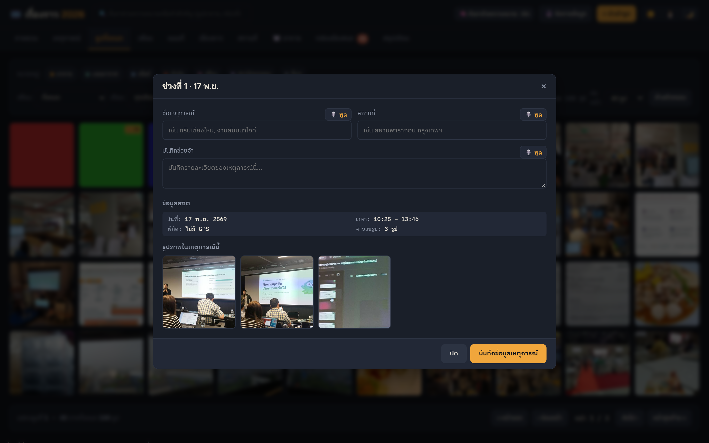
*ภาพที่ 3: หน้ารูปทั้งหมด (Photos View) พร้อมระบบแบ่งหน้า 20/40/60 รูปต่อหน้า และตัวกรองครบวงจร*

* **หน้าต่างรายละเอียดรูปภาพ (Photo Modal):**
  - ดับเบิลคลิกหรือคลิกที่รูปภาพเพื่อเปิดหน้าต่างขนาดใหญ่
  - **จดโน้ตด้วยเสียง (Voice Input):** กดไอคอนไมโครโฟน 🎙️ เพื่อพูดบันทึกเรื่องราวภาษาไทย
  - **แก้ไขวันเวลา/พิกัด:** สามารถใส่วันที่ถ่ายจริงได้ (กรณีเป็นรูปที่ไม่มี EXIF) ซึ่งระบบจะนำรูปกลับไปจัดกลุ่มเหตุการณ์ให้อัตโนมัติทันที
  - **แท็กเพื่อนและหมวดหมู่:** คลิกเลือกหมวดหมู่หรือชื่อเพื่อนได้ทันที ข้อมูลจะบันทึกแบบ Real-time

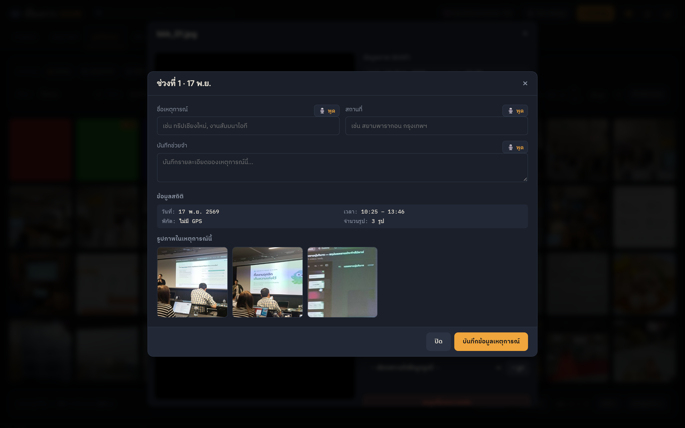
*ภาพที่ 4: หน้าต่างรายละเอียดรูปภาพ แสดงข้อมูล EXIF, แท็กหมวดหมู่, แท็กเพื่อนร่วมเฟรม, และการจดโน้ตด้วยเสียง*

---

### 2.4 เหตุการณ์และไทม์ไลน์ (Events View)
เข้าใช้งานได้จากแถบเมนู **"เหตุการณ์"**
* **บัตรคอนแทกต์ชีต (Contact Sheet Cards):**
  - แต่ละการ์ดแสดงรูปพรีวิวเด่น 1–4 รูป, ช่วงวันเวลา, สถานที่, จำนวนรูปทั้งหมด, และรายชื่อเพื่อนที่อยู่ร่วมในเหตุการณ์
  - มีแถบแบ่งตาม **เดือนและปี (Month/Year Section Banners)** เช่น `📅 พฤศจิกายน 2569 · 16 เหตุการณ์`
* **การแก้ไขและตั้งชื่อเหตุการณ์:**
  - เหตุการณ์ที่เพิ่งนำเข้าจะมีป้ายกำกับสีส้มว่า **"รอตั้งชื่อ"**
  - คลิกเข้าไปเพื่อตั้งชื่อ เช่น *"งานแต่งงานพี่บอย"*, บันทึกสถานที่ เช่น *"โรงแรมแกรนด์ไฮแอท"*, หรือกดไมโครโฟนเพื่อพูดบันทึกสรุปเรื่องราวของวันนั้น

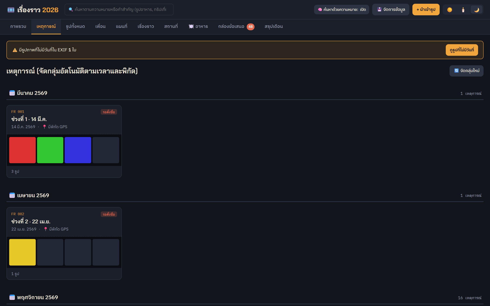
*ภาพที่ 5: หน้าเหตุการณ์ (Events View) จัดเรียงไทม์ไลน์เป็นคอนแทกต์ชีตและแบ่งหมวดหมู่ตามเดือน/ปี*

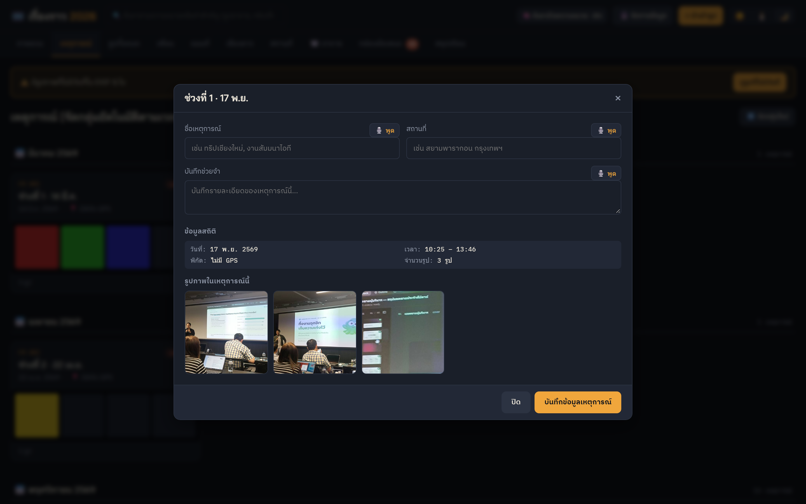
*ภาพที่ 6: หน้าต่างรายละเอียดเหตุการณ์ สามารถแก้ไขชื่อ บันทึกสถานที่ โน้ตด้วยเสียง และดูรูปทั้งหมดในเหตุการณ์*

---

### 2.5 เพื่อนและความสัมพันธ์ (Friends & Social Insights)
เข้าใช้งานได้จากแถบเมนู **"เพื่อน"**
* **สถิติความผูกพันคำนวณอัตโนมัติ:**
  - จำนวนรูปที่ถ่ายร่วมกัน (Photos Together)
  - จำนวนเหตุการณ์ที่เจอกัน (Events Together)
  - **วันที่เจอกันครั้งแรก (First Met)** และ **วันที่เจอกันล่าสุด (Last Met)**
* **ไทม์ไลน์การพบปะ (Meeting Timeline):**
  - แสดงประวัติการเจอกันในแต่ละเหตุการณ์ย้อนหลังอย่างเป็นระเบียบ
* **อัลบั้มของขวัญ "X & ME":**
  - รวมรูปถ่ายความทรงจำระหว่างคุณกับเพื่อนคนนั้น และสามารถกดส่งออก (Export) เป็นของขวัญให้เพื่อนได้
* **ระบบแนะนำเพื่อนที่ไม่เจอกันนาน (Lapsed Friends):**
  - แจ้งเตือนเมื่อเพื่อนคนสำคัญไม่ได้พบเจอกันเกิน 6 เดือน เพื่อเป็นไอเดียในการทักทายพูดคุย


*ภาพที่ 7: หน้าเพื่อนและความสัมพันธ์ (Friends View) แสดงการ์ดเพื่อนพร้อมสถิติจำนวนรูปและเหตุการณ์ที่ร่วมเฟรม*

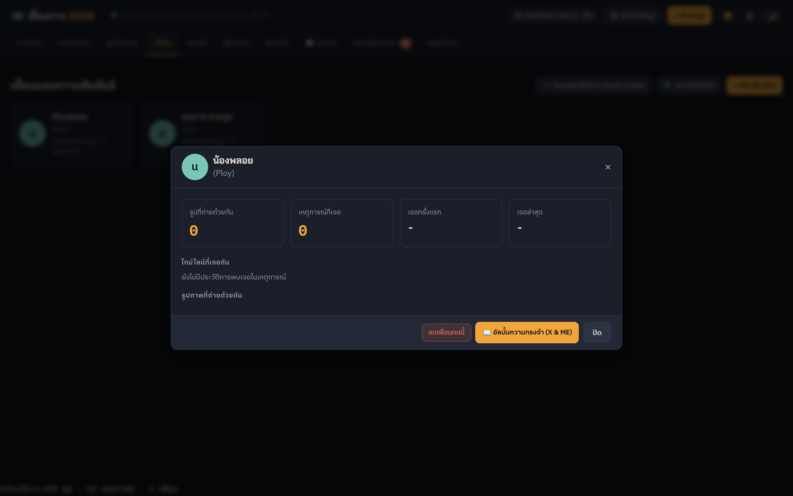
*ภาพที่ 8: หน้าต่างโปรไฟล์เพื่อนเจาะลึก (Friend Detail) แสดงวันแรก-วันล่าสุดที่เจอกัน และไทม์ไลน์การพบปะย้อนหลัง*

* **แผนผังเครือข่ายมิตรภาพ (Social Graph):**
  - กดปุ่ม **"🕸️ แผนผังเครือข่าย (Social Graph)"** เพื่อดูความเชื่อมโยงของกลุ่มเพื่อนในเหตุการณ์ต่าง ๆ เส้นที่หนาขึ้นจะแสดงถึงความถี่ในการพบเจอกันบ่อยครั้ง

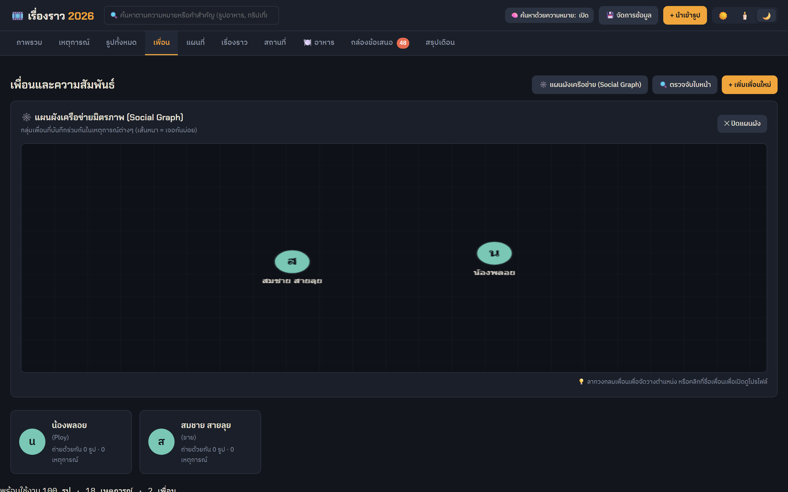
*ภาพที่ 9: แผนผังเครือข่ายมิตรภาพ (Social Graph) แสดงความเชื่อมโยงของเพื่อนที่มักปรากฏตัวร่วมกัน*

---

### 2.6 เรื่องราวเฉพาะเรื่องและไดอารี่มื้ออาหาร (Thematic Collections & Meal Diary)
* **หน้าเรื่องราวเฉพาะเรื่อง (Thematic Stories):**
  - รวบรวมรูปถ่ายตามหัวข้อความสนใจ เช่น คอลเลกชันสไลด์ที่น่าสนใจ, สถาปัตยกรรม, หรือโปรเจกต์ตกแต่งคอนโดแบบ Before $\rightarrow$ After


*ภาพที่ 10: หน้าเรื่องราวเฉพาะเรื่อง (Thematic Stories) แสดงคอลเลกชันหัวข้อต่าง ๆ พร้อมจำนวนรูปและช่วงเวลา*

* **ไดอารี่มื้ออาหาร (Meal Diary):**
  - รวมรูปอาหาร เครื่องดื่ม และบรรยากาศของร้านในมื้อนั้นเป็นหน่วยเดียว
  - เชื่อมโยงกับ **ชื่อร้านอาหาร (Place)** ซึ่งจะถูกนำกลับมาใช้ซ้ำเมื่อคุณไปทานร้านเดิมในอนาคต
  - ให้คะแนนความประทับใจ (1–5 ดาว) และจดรายการอาหารจานเด็ดได้

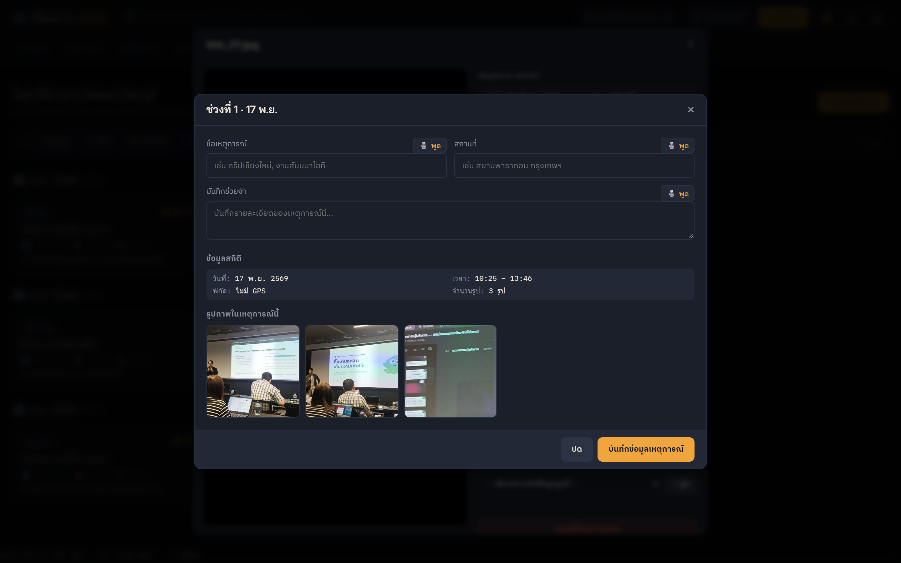
*ภาพที่ 11: ไดอารี่มื้ออาหาร (Meal Diary) รวมรูปอาหาร บรรยากาศ คะแนนดาว และเพื่อนร่วมโต๊ะ*

---

### 2.7 สถานที่และแผนที่ความทรงจำ (Places & Map View)
* **การจัดกลุ่มหมุดบนแผนที่ (Leaflet Marker Clustering):**
  - รูปภาพที่ถ่ายในรัศมีใกล้กัน (~110 เมตร) จะถูกรวมเป็น **หมุดคลัสเตอร์สีทองพร้อมตัวเลขบอกจำนวนรูป**
  - เมื่อคลิกที่หมุดจะมีหน้าต่าง Popup พรีวิวภาพขนาดย่อ และมีปุ่มขยายซูมแผนที่เข้าไปยังจุดนั้น

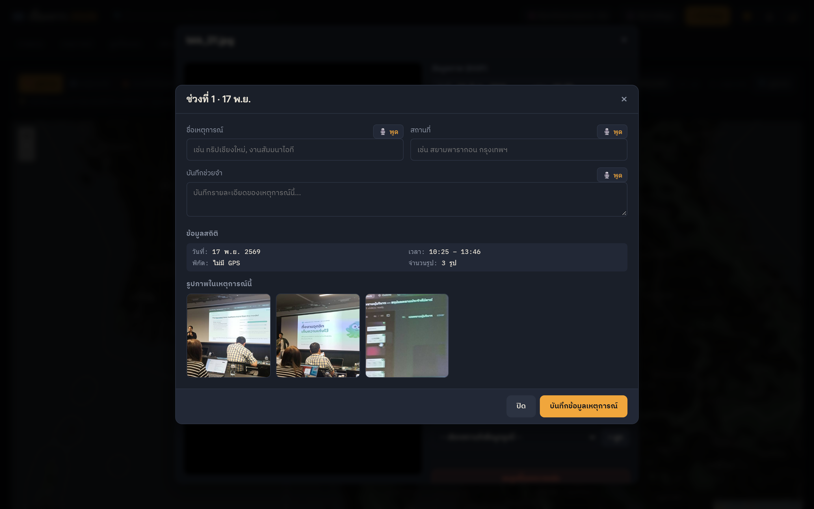
*ภาพที่ 12: แผนที่ความทรงจำ (Map Explorer) แสดงหมุดคลัสเตอร์สีทองพร้อมจำนวนรูป พรีวิวภาพ และปุ่มซูม*

* **การกำหนดหมุดสถานที่สำคัญ (Named Places Anchor):**
  - สร้างหมุดสถานที่ เช่น *"คอนโดของฉัน"*, *"บ้านคุณแม่"*, *"ออฟฟิศ"* พร้อมกำหนดรัศมีตรวจจับ (ค่าเริ่มต้น 120 เมตร)
  - รูปใหม่ที่มีพิกัด GPS ตกอยู่ในบริเวณดังกล่าว จะได้รับการเสนอให้เชื่อมโยงเข้ากับสถานที่นั้นโดยอัตโนมัติ


*ภาพที่ 13: หน้าสถานที่สำคัญ (Places View) ปักหมุดพิกัด GPS ประจำ พร้อมบันทึกประวัติการมาเยือน*

---

### 2.8 สรุปความทรงจำประจำเดือนและประจำปี (Recap Stories)
เข้าใช้งานได้จากแถบเมนู **"สรุปเรื่องราว (Recap)"**
* **เรื่องเล่าสั้นประจำเดือน (Short Thai Narrative):**
  - ระบบสร้างบทความเล่าเรื่องสั้นภาษาไทยแบบกระชับ (อ่านจบได้ใน 30 วินาที)
  - ประมวลผลจากจำนวนรูปทั้งหมด, เหตุการณ์สำคัญ, เพื่อนที่เจอบ่อยที่สุด, ร้านอาหารใหม่ที่ได้ไปลอง, และคอลเลกชันที่มีความเคลื่อนไหว
* **รูปไฮไลต์ยอดเยี่ยม (Keeper Highlights):**
  - คัดเลือกภาพเด่น 4–6 ภาพจากเหตุการณ์ต่าง ๆ ในเดือนนั้น โดยคัดรูปถ่ายรัวและรูปเบลอออก
* **การส่งออกรายงาน (Export):**
  - สามารถดาวน์โหลดเก็บไว้หรือแชร์ในรูปแบบ **HTML**, **PDF**, หรือ **รูปภาพการ์ดสรุปความทรงจำ**


*ภาพที่ 14: หน้าสรุปเรื่องราวประจำเดือน (Monthly Recap) แสดงเรื่องเล่าภาษาไทยและรูปเด่นประจำเดือน*

---

### 2.9 การสำรองและกู้คืนข้อมูล (Backup & Restore)
* **สำรองข้อมูล (Backup):**
  - ส่งออกข้อมูลแท็ก, โน้ต, ชื่อเหตุการณ์, บันทึกเพื่อน, และเรื่องราวทั้งหมดเป็นไฟล์ JSON ขนาดกะทัดรัด
  - ไฟล์ JSON ใช้รหัส `sha256` เป็นตัวจับคู่รูป ทำให้สามารถนำข้อมูลไปกู้คืนบนเครื่องคอมพิวเตอร์เครื่องอื่นที่มีไฟล์รูปเดียวกันได้อย่างแม่นยำ
* **กู้คืนข้อมูล (Restore):**
  - นำเข้าไฟล์ JSON เพื่อเชื่อมโยงข้อมูลและโครงสร้างเหตุการณ์กลับคืนมาทั้งหมดได้ทันที


*ภาพที่ 15: หน้าต่างจัดการข้อมูล (Manage Data Modal) รองรับการสำรองข้อมูลเป็นไฟล์ JSON และการกู้คืน*

---

## 3. เจาะลึกเทคโนโลยี AI และเบื้องหลังการทำงาน

เบื้องหลังความเรียบง่ายของระบบ Photostory คือการทำงานประสานกันของอัลกอริทึมและโมเดล Machine Learning ออนดีไวซ์ที่ถูกออกแบบมาเป็นพิเศษเพื่อรองรับข้อมูลภาพถ่ายระดับ 50,000+ รูป:

```
┌────────────────────────────────────────────────────────────────────────┐
│                        DATA INGESTION PIPELINE                         │
├───────────────┬───────────────────┬────────────────────────────────────┤
│ 1. Metadata   │ exifr             │ วันเวลา (taken_at), GPS (lat/lon)  │
│ 2. Exact Hash │ crypto.createHash │ SHA-256 (32 bytes hex) ป้องกันรูปซ้ำ │
│ 3. Perceptual │ sharp + DCT pHash │ 64-bit DCT pHash ตรวจรูปคล้าย      │
│ 4. Thumbnail  │ sharp             │ Lanczos3 560px, JPEG q=0.72        │
└───────────────┴───────────────────┴────────────────────────────────────┘
                                   │
                                   ▼
┌────────────────────────────────────────────────────────────────────────┐
│                    SPATIOTEMPORAL & GROUPING CORE                      │
├───────────────┬───────────────────┬────────────────────────────────────┤
│ 5. Clustering │ Haversine + Gap   │ Δt > 4 ชม. หรือ Δd > 2 กม. แยก Event│
│ 6. Burst Shot │ Sliding Window    │ Δt ≤ 2 วินาที มาร์กเป็น burst=1     │
│ 7. Meal Group │ Heuristic Cluster │ หมวดอาหาร + บรรยากาศ (90น., 120ม.)  │
└───────────────┴───────────────────┴────────────────────────────────────┘
                                   │
                                   ▼
┌────────────────────────────────────────────────────────────────────────┐
│                    LOCAL AI & ON-DEVICE EMBEDDINGS                     │
├───────────────┬───────────────────┬────────────────────────────────────┤
│ 8. Face AI    │ SCRFD + ArcFace   │ ONNX Runtime 512-d Face Vectors    │
│               │ Greedy Clustering │ Cosine Similarity (Threshold 0.45) │
├───────────────┼───────────────────┼────────────────────────────────────┤
│ 9. Semantic   │ Multilingual CLIP │ 512-d Multimodal Image-Text Space  │
│    Search     │ sqlite-vec        │ Cosine Top-K Vector Distance Match │
├───────────────┼───────────────────┼────────────────────────────────────┤
│ 10. Thai FTS  │ SQLite FTS5       │ Trigram Tokenizer 3 ตัวอักษร       │
└───────────────┴───────────────────┴────────────────────────────────────┘
```

---

### 3.1 การจัดกลุ่มเหตุการณ์ตามเวลาและพิกัด (Spatiotemporal Event Clustering)
**โมดูล:** `server/workers/cluster.ts`

ระบบจัดกลุ่มรูปถ่ายนับพันรูปให้กลายเป็น "เหตุการณ์" (Events) โดยไม่ต้องพึ่งพา AI ภายนอก แต่อาศัยอัลกอริทึม Spatiotemporal Clustering:
1. **การเรียงลำดับเวลา (Temporal Ordering):** เรียงรูปภาพทั้งหมดตาม `taken_at` จากอดีตไปหาปัจจุบัน
2. **เงื่อนไขการตัดแบ่งกลุ่ม (Cluster Boundary Conditions):**
   รูปภาพถัดไปจะถูกแยกออกเป็นเหตุการณ์ใหม่ เมื่อเข้าเงื่อนไขข้อใดข้อหนึ่งดังนี้:
   - **ความต่างของเวลา (Time Gap):** ห่างจากรูปก่อนหน้าเกินกว่า `gap_hours` (ค่าเริ่มต้นคือ 4 ชั่วโมง)
   - **ความต่างของระยะทาง (Spatial Distance):** พิกัด GPS ห่างจากจุดกึ่งกลาง (Centroid) ของกลุ่มปัจจุบันเกินกว่า `dist_km` (ค่าเริ่มต้นคือ 2 กิโลเมตร)
3. **สูตรคำนวณระยะทางบนผิวโลก (Haversine Formula):**
   การคำนวณระยะห่างระหว่างพิกัดละติจูด/ลองจิจูดสองจุดใช้สูตรฮาเวอร์ซีนบนทรงกลมโลกที่มีรัศมีเฉลี่ย $R = 6,371$ กิโลเมตร:
   $$\Delta\text{lat} = \text{rad}(\text{lat}_2 - \text{lat}_1), \quad \Delta\text{lon} = \text{rad}(\text{lon}_2 - \text{lon}_1)$$
   $$a = \sin^2\left(\frac{\Delta\text{lat}}{2}\right) + \cos(\text{rad}(\text{lat}_1))\cos(\text{rad}(\text{lat}_2))\sin^2\left(\frac{\Delta\text{lon}}{2}\right)$$
   $$d = 2 R \cdot \arcsin\left(\sqrt{a}\right)$$
4. **กลไกถนอมข้อมูลผู้ใช้ (Preserving Named Events):**
   เมื่อมีการจัดกลุ่มใหม่ (เช่น หลังการแก้ไขวันที่หรือลบรูป) ระบบจะตรวจสอบว่าสมาชิกรูปภาพเดิมเคยอยู่ในเหตุการณ์ที่ผู้ใช้เคยตั้งชื่อไว้หรือไม่ หากเคยตั้งชื่อไว้ ระบบจะ **คงชื่อเดิม สถานที่เดิม และโน้ตเดิมไว้เสมอ** ไม่ล้างข้อมูลที่ผู้ใช้พิมพ์ทิ้ง

---

### 3.2 การตรวจจับรูปถ่ายรัวและรูปซ้ำ (Burst Detection & Perceptual Hashing)
**โมดูล:** `server/workers/ingest.ts` และ `server/workers/cluster.ts`

* **การตรวจจับภาพถ่ายรัว (Burst Detection):**
  - ในสตรีมภาพที่เรียงตามเวลา หากภาพคู่ใดมีเวลาห่างกัน $\le 2,000$ มิลลิวินาที (2 วินาที) ทั้งสองรูปจะถูกตั้งค่า `burst = 1`
  - หากมีการกดถ่ายรัวต่อเนื่องเป็นชุด (Chain bursts) ทุกภาพในชุดนั้นจะถูกจัดเป็น Burst Group ทั้งหมด เพื่อให้ผู้ใช้สามารถคัดเลือก "Best Shot" และเก็บภาพที่เหลือไว้โดยไม่เกะกะสายตา
* **การตรวจจับภาพซ้ำ 2 ระดับ:**
  - **Exact Duplicate (SHA-256):** ตรวจสอบไบนารีระดับไฟล์ หากค่าแฮชตรงกัน แปลว่าเป็นไฟล์ภาพเดียวกัน 100% ระบบจะข้ามการนำเข้าทันที
  - **Near-Duplicate (Perceptual Hash - pHash):** ใช้ขั้นตอนการทำ DCT (Discrete Cosine Transform) โดยย่อภาพเป็น Grayscale $32 \times 32$ พิกเซล $\rightarrow$ คำนวณความถี่ต่ำ $8 \times 8$ ส่วนบนซ้าย $\rightarrow$ ตัดด้วยค่ามัธยฐาน (Median) ออกมาเป็นบิตสตรีม 64 บิต
  - คำนวณความต่างของภาพด้วย **Hamming Distance**:
    $$\text{Hamming}(H_1, H_2) \le 6$$
    หากต่างกันไม่เกิน 6 บิตจาก 64 บิต จะถูกแจ้งเตือนเป็นภาพใกล้เคียงกัน (เช่น รูปที่ส่งผ่านแอปแชตแล้วถูกบีบอัด หรือรูปมุมเดียวกันแต่เปลี่ยนสีเล็กน้อย) เพื่อให้ผู้ใช้เลือกเก็บรูปที่ดีที่สุด

---

### 3.3 การตรวจจับและรู้จำใบหน้า (Face Detection, Embedding & Clustering)
**โมดูล:** `server/workers/face.ts` และ `server/routes/faces.ts`

ระบบระบุเพื่อนในภาพทำงานแบบ On-device ออฟไลน์ 100% ผ่านโครงข่ายประสาทเทียมลึก (Deep Neural Network):

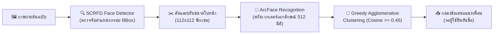

1. **สถาปัตยกรรมโมเดล (Deep Models via ONNX Runtime Node):**
   - **SCRFD (Sample and Computation Redistribution for Face Detection):** ตรวจจับตำแหน่งใบหน้าในภาพ คำนวณพิกัด Bounding Box แบบปรับขนาดอัตราส่วนคงที่
   - **ArcFace (Additive Angular Margin Loss):** สกัดลักษณะทางกายวิภาคของใบหน้า แปลงเป็นเวกเตอร์ $512$ มิติ ($\vec{v} \in \mathbb{R}^{512}$) และทำการ Normalization แบบ L2 ($||\vec{v}|| = 1$)
2. **การจัดกลุ่มใบหน้าเพื่อนด้วย Greedy Agglomerative Clustering:**
   - เมื่อสกัดเวกเตอร์ใบหน้าได้ ระบบจะคำนวณความเหมือนด้วย **Cosine Similarity** (ซึ่งเทียบเท่ากับ Dot Product เนื่องจากเวกเตอร์ถูก Normalize แล้ว):
     $$\text{Cosine}(\vec{a}, \vec{b}) = \vec{a} \cdot \vec{b}$$
   - หากความเหมือนกับจุดศูนย์กลาง (Centroid) ของกลุ่มใดมีค่า $\ge 0.45$ ใบหน้าจะถูกจัดเข้ากลุ่มเพื่อนคนนั้น และปรับค่า Centroid ใหม่
   - หากไม่ตรงกับกลุ่มใดเลย ระบบจะสร้างกลุ่มใบหน้าใหม่ขึ้นมา
3. **ระบบผู้ใช้เป็นศูนย์กลาง (Human-in-the-Loop):**
   - AI จะไม่แอบตั้งชื่อเพื่อนเอง แต่จะส่งเป็นข้อเสนอแนะ (Suggestions) เข้าสู่กล่องข้อความ เช่น *"พบใบหน้าคนนี้ 12 รูป — คนนี้คือใคร?"*
   - เมื่อผู้ใช้พิมพ์หรือพูดชื่อเพื่อนเพียงครั้งเดียว ระบบจะผูกใบหน้าทั้งหมดเข้ากับโปรไฟล์เพื่อนคนนั้นทันที

---

### 3.4 การค้นหาความหมายด้วยภาษาไทย (Multilingual Semantic Search via CLIP)
**โมดูล:** `server/workers/embed.ts` และ `server/routes/search.ts`

เมื่อผู้ใช้พิมพ์ค้นหาด้วยประโยคภาษาไทย เช่น *"รูปอาหารตอนกลางคืน"*, *"บรรยากาศนั่งทำงาน"*, หรือ *"วิวภูเขาหมอก"* แม้ในโน้ตจะไม่มีคำเหล่านี้ แต่ระบบสามารถค้นพบภาพที่เกี่ยวข้องได้:

1. **Multimodal Embedding Space:**
   - ใช้โมเดล **Multilingual CLIP (Contrastive Language-Image Pretraining)**
   - โมเดลนี้ถูกเทรนให้แมปภาพถ่ายและข้อความหลายภาษา (รวมถึงภาษาไทย) ให้อยู่ในปริภูมิเวกเตอร์ 512 มิติเดียวกัน
   - ข้อความที่มีความหมายสอดคล้องกับเนื้อหาในภาพ จะมีเวกเตอร์ชี้ไปในทิศทางเดียวกันในอวกาศเวกเตอร์
2. **การค้นหาเวกเตอร์ในระดับฐานข้อมูล (`sqlite-vec`):**
   - เวกเตอร์ของภาพขนาด 512 มิติจะถูกเก็บลงตารางเสมือน `photo_vec` ภายในไฟล์ SQLite เดียวกัน
   - เมื่อผู้ใช้ค้นหา ข้อความภาษาไทยจะถูก Encode เป็นเวกเตอร์ แล้วใช้คำสั่ง `MATCH` เพื่อคำนวณ Cosine Distance หาภาพ Top-K ที่ใกล้เคียงที่สุดในเสี้ยววินาที
3. **กลไกสำรอง (Semantic Concept Anchors Fallback):**
   - กรณีที่ยังไม่ได้เปิดดาวน์โหลดโมเดลขนาดใหญ่ ระบบมีระบบสำรองแบบ **Concept Anchor Projection** ที่แมปคำสำคัญภาษาไทยยอดนิยม (อาหาร, ท่องเที่ยว, ทำงาน, รถยนต์, สัตว์เลี้ยง) เข้าสู่มิติเวกเตอร์ 512 มิติโดยตรง ทำให้ระบบสามารถค้นหาเชิงความหมายได้ในทันทีโดยไม่ต้องรอโหลดโมเดลหลายร้อยเมกะไบต์

---

### 3.5 ระบบสืบค้นข้อความภาษาไทยเต็มรูปแบบ (Thai Full-Text Search via FTS5 Trigram)
**โมดูล:** `server/db.ts` และ `server/routes/search.ts`

การค้นหาข้อความภาษาไทยในฐานข้อมูลทั่วไปมักล้มเหลว เนื่องจาก **ภาษาไทยเขียนติดกันเป็นพืดโดยไม่มีการเว้นวรรคระหว่างคำ** (Unsegmented Text)
* ตัวตัดคำภาษาอังกฤษทั่วไป (เช่น `unicode61`) มองประโยค `"กินก๋วยเตี๋ยวเรือ"` เป็นคำเดียว ไม่สามารถค้นหาด้วยคำว่า `"ก๋วยเตี๋ยว"` ได้
* **ทางแก้ปัญหาของ Photostory:** ระบบใช้ **SQLite FTS5 Trigram Tokenizer**
  ```sql
  CREATE VIRTUAL TABLE search_fts USING fts5(
    kind, ref_id, text, tokenize = 'trigram'
  );
  ```
* **หลักการทำงานของ Trigram:** ระบบจะย่อยข้อความออกเป็นชิ้นย่อยขนาด 3 ตัวอักษรต่อเนื่องกันเสมอ เช่น:
  `"เชียงใหม่"` $\rightarrow$ `['เชิ', 'ชีย', 'ียง', 'งให', 'ใหม่']`
* วิธีนี้ทำให้การพิมพ์คำค้นหาภาษาไทย ไม่ว่าจะเป็นชื่อเพื่อน, สถานที่, หรือข้อความในโน้ต สามารถจับคู่คำได้อย่างแม่นยำ 100% โดยไม่ต้องพึ่งพาโมเดลพจนานุกรมตัดคำที่กินแรม

---

### 3.6 การจัดกลุ่มมื้ออาหารและจับคู่พิกัด (Meal Grouping & Geofencing)
**โมดูล:** `server/workers/suggest.ts`

* **การรวมภาพเข้าสู่มื้ออาหาร (Meal Aggregation Heuristic):**
  - ค้นหารูปที่อยู่ในหมวดหมู่ `อาหาร` และรูปในหมวด `บรรยากาศ` ที่ถ่ายในพิกัดเดียวกัน
  - หากระยะเวลาห่างกันไม่เกิน 90 นาที และพิกัดห่างกันไม่เกิน 120 เมตร ระบบจะรวมเป็น **"1 มื้ออาหาร"**
  - **จำแนกประเภทมื้ออาหารตามช่วงเวลาของวัน (Time-of-day Heuristic):**
    - 05:00 – 10:59 น. $\rightarrow$ **อาหารเช้า (Breakfast)**
    - 11:00 – 14:59 น. $\rightarrow$ **อาหารกลางวัน (Lunch)**
    - 17:00 – 21:59 น. $\rightarrow$ **อาหารเย็น (Dinner)**
    - เวลาอื่น ๆ $\rightarrow$ **คาเฟ่ / ของว่าง (Cafe / Other)**
* **การจับคู่พิกัดสถานที่ประจำ (Spatial Geofencing):**
  - สำหรับสถานที่สำคัญ (Places) เช่น ร้านอาหารประจำ หรือบ้าน/คอนโด
  - ระบบตรวจสอบระยะห่างด้วย Haversine Formula หากรูปใหม่มีพิกัดตกอยู่ในรัศมี $r \le 120$ เมตร ระบบจะผูกรูปภาพเข้ากับสถานที่นั้นให้ทันทีโดยอัตโนมัติ

---

### 3.7 การคัดเลือกรูปยอดเยี่ยมและแต่งบทความเล่าเรื่อง (Keeper Heuristics & Storytelling)
**โมดูล:** `server/workers/recap.ts`

* **อัลกอริทึมคัดเลือกรูปเด่น (Keeper Selection):**
  ในการสร้างสรุปประจำเดือน ระบบจะต้องเลือก 4–6 รูปที่ดีที่สุดเพื่อเป็นตัวแทนของเดือนนั้น:
  1. ตัดรูปที่เป็น Burst Shot ออก เหลือเพียงรูปตัวแทนรูปเดียว
  2. ให้ความสำคัญกับรูปที่ผู้ใช้ติดดาวหรือตั้งค่าเป็น Favorite ก่อน
  3. คัดเลือกโดยวัดความคมชัดเบื้องต้น (Sharpness & Resolution Proxy): อัตราส่วนขนาดไฟล์ต่อพิกเซล ($\text{Bytes} / (\text{Width} \times \text{Height})$)
  4. กระจายการเลือกให้ครอบคลุมหลากหลายเหตุการณ์ เพื่อให้เรื่องราวไม่กระจุกตัวอยู่ที่วันใดวันหนึ่ง
* **เครื่องมือแต่งบทความสรุปภาษาไทย (Template-driven Narrative Engine):**
  - รวบรวมสถิติความจริง (Ground-truth Facts) ประจำเดือน: จำนวนรูป, จำนวนเหตุการณ์, เพื่อนที่พบหน้าบ่อยที่สุด, ร้านอาหารใหม่ที่ได้ไปเยือน
  - นำสถิติมาประกอบเข้ากับเทมเพลตภาษาไทยที่ถูกออกแบบมาให้อ่านเพลิน อบอุ่น และกระชับ
  - **รองรับการต่อยอด Local LLM:** สถาปัตยกรรมเตรียมพร้อมเชื่อมโยงกับโมเดลภาษาในเครื่อง (เช่น Qwen2.5 หรือ Typhoon ผ่าน Ollama) เพื่อขัดเกลาสำนวนภาษาให้มีความเป็นวรรณกรรมยิ่งขึ้นได้โดยไม่ต้องพึ่งพาคลาวด์

---

### 3.8 สถาปัตยกรรมประมวลผลเบื้องหลัง (Background Workers & Job Resilience)
**โมดูล:** `server/workers/jobs.ts`

* **Non-blocking Event Loop:** งานคำนวณที่ใช้ CPU หนัก (เช่น การแปลงไฟล์ภาพด้วย sharp, การสแกน EXIF นับหมื่นรูป, หรือการรันโมเดล AI) จะถูกแบ่งชิ้นงานประมวลผลเป็น Batch และสั่ง Yield ให้กับ Event Loop ของ Node.js ผ่าน `setImmediate()` ทุก ๆ 25 ไฟล์ ทำให้หน้าเว็บยังคงลื่นไหลและตอบสนองได้ตลอดเวลา
* **ความทนทานต่องานหยุดชะงัก (Idempotent & Resumable):**
  - งานนำเข้าและงานประมวลผลเวกเตอร์ถูกออกแบบให้ทำซ้ำได้ (Idempotent)
  - หากไฟดับหรือปิดโปรแกรมระหว่างทาง เมื่อเปิดโปรแกรมใหม่และสั่งประมวลผลต่อ ระบบจะตรวจสอบรหัสที่ทำเสร็จแล้วใน SQLite และกระโดดข้ามไปยังไฟล์ที่ยังค้างอยู่ได้ทันทีโดยไม่เริ่มนับหนึ่งใหม่

---

## 4. ข้อกำหนดระบบและการดูแลรักษา

### สเปกคอมพิวเตอร์ที่แนะนำ
* **ระบบปฏิบัติการ:** Windows 10/11, macOS, หรือ Linux
* **CPU:** 4 Cores ขึ้นไป (Intel Core i5 / AMD Ryzen 5 / Apple Silicon M1 ขึ้นไป)
* **RAM:** ขั้นต่ำ 4 GB (แนะนำ 8 GB ขึ้นไปสำหรับการประมวลผลรูปจำนวนมาก)
* **พื้นที่ดิสก์:** พื้นที่ว่างสำหรับจัดเก็บฐานข้อมูลและภาพขนาดย่อประมาณ 1.5 GB ต่อรูปภาพ 10,000 รูป (ไฟล์ต้นฉบับอยู่ที่เดิม)

### แผนที่โครงสร้างข้อมูลของระบบ (Data Directory Map)
```text
photostory/
├── data/
│   ├── story.db          # ฐานข้อมูล SQLite หลัก (ข้อมูลทั้งหมดอยู่ที่นี่ไฟล์เดียว)
│   ├── story.db-wal      # Write-Ahead Log เพื่อความเร็วในการบันทึก
│   ├── thumbs/           # ไฟล์ภาพขนาดย่อความเร็วสูง (560px)
│   ├── recaps/           # แคชบทความสรุปประจำเดือน/ประจำปี
│   └── models/           # ไฟล์โมเดล ONNX สำหรับประมวลผลใบหน้าและเวกเตอร์
├── photo/                # โฟลเดอร์รูปภาพตัวอย่างหรือรูปภาพของคุณ
├── screenshot/           # แกลเลอรีภาพหน้าจอการใช้งานจริงทั้งหมด 15 หน้าจอ
└── server/               # รหัสโปรแกรมฝั่งเซิร์ฟเวอร์และ AI Workers
```

### คำถามที่พบบ่อย (FAQ)

**Q: ทำไมรูปบางรูปถึงไม่แสดงพิกัดบนแผนที่?**
> **A:** รูปภาพนั้นอาจไม่มีการบันทึก GPS ในชิป EXIF ของกล้อง (เช่น ปิด Location Services ในโทรศัพท์ขณะถ่าย หรือเป็นภาพที่ดาวน์โหลดมาจาก LINE/Facebook ซึ่งถูกตัดพิกัดออกเพื่อความเป็นส่วนตัว) คุณสามารถเปิดดูรูปนั้นและระบุสถานที่ด้วยตนเองได้ในระบบ

**Q: ถ้าต้องการย้ายเครื่องคอมพิวเตอร์ ต้องทำอย่างไร?**
> **A:** คุณสามารถทำได้ 2 วิธีง่าย ๆ:
> 1. ไปที่เมนู **"สำรองข้อมูล"** แล้วดาวน์โหลดไฟล์ JSON เก็บไว้ นำไฟล์รูปไปไว้ที่เครื่องใหม่ นำเข้าภาพ และกด **"กู้คืนข้อมูล"** ด้วยไฟล์ JSON นั้น
> 2. หรือคัดลอกโฟลเดอร์ `data/story.db` และโฟลเดอร์ภาพเดิมไปยังเครื่องใหม่ได้โดยตรง

**Q: การลบรูปในโปรแกรมนี้ จะทำให้ไฟล์จริงหายไหม?**
> **A:** **ไม่หายครับ** ระบบยึดหลัก Non-destructive อย่างเคร่งครัด การกดลบในโปรแกรมจะเป็นการลบเพียงประวัติในฐานข้อมูลและภาพขนาดย่อเท่านั้น ไฟล์ภาพต้นฉบับในฮาร์ดดิสก์ของคุณจะยังคงอยู่ปลอดภัย 100%

---

## 5. รวมภาพหน้าจอการใช้งานจริง (Visual Interface Gallery)

ภาพหน้าจอทั้งหมดถูกจับจากระบบการทำงานจริงด้วยความละเอียดระดับ HiDPI และจัดเก็บไว้ในโฟลเดอร์ `screenshot/`:

| ลำดับ | ไฟล์ภาพหน้าจอ | หน้าจอและมุมมอง | คำอธิบายและฟังก์ชันหลัก |
|:---:|:---|:---|:---|
| 01 | [`screenshot/01-dashboard.png`](screenshot/01-dashboard.png) | **หน้าภาพรวม (Dashboard)** | การ์ดตัวเลขนับสถิติรวมทั้งหมด, กราฟฮิสโตแกรมจังหวะการถ่ายรูป 12 เดือน, คิว "รอคุณเติมข้อมูล", และกล่องความทรงจำ "วันนี้ในอดีต" |
| 02 | [`screenshot/02-events.png`](screenshot/02-events.png) | **หน้าเหตุการณ์ (Events)** | ไทม์ไลน์คอนแทกต์ชีตจัดหมวดหมู่แยกตามแบนเนอร์เดือนและปี เช่น `📅 พฤศจิกายน 2569` พร้อมป้าย "รอตั้งชื่อ" |
| 03 | [`screenshot/03-event-detail.png`](screenshot/03-event-detail.png) | **รายละเอียดเหตุการณ์ (Event Detail)** | หน้าต่างแก้ไขชื่อเหตุการณ์, ระบุสถานที่, พูดจดโน้ตด้วยเสียง, และแกลเลอรีรูปภาพทั้งหมดในเหตุการณ์ |
| 04 | [`screenshot/04-photos.png`](screenshot/04-photos.png) | **หน้ารูปทั้งหมด (Photos View)** | แกลเลอรีรูปภาพพร้อมตัวเลือกแบ่งหน้า **Pagination 20/40/60 รูปต่อหน้า**, ตัวกรอง 7 หมวดหมู่, ตัวกรองเพื่อน, และจุดสีสถานะ |
| 05 | [`screenshot/05-photo-modal.png`](screenshot/05-photo-modal.png) | **รายละเอียดรูปภาพ (Photo Modal)** | หน้าต่างแสดงภาพขนาดใหญ่, ข้อมูล EXIF, แท็กหมวดหมู่, แท็กเพื่อนร่วมเฟรม, และการพูดจดโน้ตด้วยเสียง |
| 06 | [`screenshot/06-friends.png`](screenshot/06-friends.png) | **หน้าเพื่อน (Friends View)** | รายการโปรไฟล์เพื่อนพร้อมสถิติจำนวนรูปและจำนวนเหตุการณ์ที่พบเจอกัน |
| 07 | [`screenshot/07-friend-detail.png`](screenshot/07-friend-detail.png) | **โปรไฟล์เพื่อนเจาะลึก (Friend Detail)** | สถิติ 4 มิติ (จำนวนรูป, จำนวนเหตุการณ์, วันแรกที่เจอ, วันล่าสุดที่เจอ) และไทม์ไลน์ประวัติการพบเจอ |
| 08 | [`screenshot/08-social-graph.png`](screenshot/08-social-graph.png) | **แผนผังเครือข่ายมิตรภาพ (Social Graph)** | แผนผังเส้นใยมิตรภาพแบบ Interactive Canvas แสดงกลุ่มเพื่อนที่ถูกบันทึกภาพร่วมกัน |
| 09 | [`screenshot/09-map.png`](screenshot/09-map.png) | **แผนที่ความทรงจำ (Map Explorer)** | แผนที่ Leaflet พร้อมหมุดคลัสเตอร์สีทองแสดงตัวเลขจำนวนรูปในบริเวณใกล้เคียง พร้อมปุ่มซูมและพรีวิวภาพ |
| 10 | [`screenshot/10-stories.png`](screenshot/10-stories.png) | **เรื่องราวเฉพาะเรื่อง (Thematic Stories)** | คอลเลกชันรวมรูปข้ามเวลา เช่น คอลเลกชันสไลด์งานสัมมนา และไทม์ไลน์ตกแต่งคอนโด |
| 11 | [`screenshot/11-meals.png`](screenshot/11-meals.png) | **ไดอารี่มื้ออาหาร (Meal Diary)** | รวมรูปอาหาร เครื่องดื่ม และบรรยากาศของร้าน, คะแนนดาว 1–5 ดาว, และเพื่อนร่วมโต๊ะ |
| 12 | [`screenshot/12-places.png`](screenshot/12-places.png) | **สถานที่สำคัญ (Places View)** | หมุดพิกัดสถานที่ประจำ (บ้าน, คอนโด, ร้านอาหาร) พร้อมประวัติการมาเยือน |
| 13 | [`screenshot/13-recap.png`](screenshot/13-recap.png) | **สรุปเรื่องราวประจำเดือน (Monthly Recap)** | บทความเรื่องเล่าสั้นภาษาไทยประจำเดือน พร้อมรูปถ่ายไฮไลต์ยอดเยี่ยม (Keeper Highlights) |
| 14 | [`screenshot/14-import-modal.png`](screenshot/14-import-modal.png) | **หน้าต่างนำเข้ารูปภาพ (Import Modal)** | ช่องระบุโฟลเดอร์แบบหลาย Path (คั่นด้วย `,` หรือ `;`) และการสแกนโฟลเดอร์ย่อยอัตโนมัติ |
| 15 | [`screenshot/15-manage-data-modal.png`](screenshot/15-manage-data-modal.png) | **หน้าต่างจัดการข้อมูล (Manage Data Modal)** | เครื่องมือสำรองข้อมูลเป็นไฟล์ JSON (Backup), การกู้คืนข้อมูล (Restore), และการส่งออกอัลบั้ม |

---
*จัดทำขึ้นสำหรับผู้ใช้งานระบบ "เรื่องราว 2026" (Photostory Project) — บันทึกทุกความทรงจำอย่างเป็นส่วนตัว ปลอดภัย และชาญฉลาดบนคอมพิวเตอร์ของคุณ*
